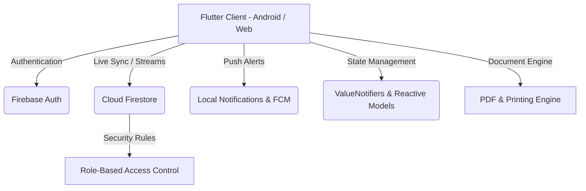

# 🏥 MedBridge - Smart Healthcare & Telemedicine Ecosystem

<div align="center">


[](https://flutter.dev)
[](https://firebase.google.com/)
[](LICENSE)
[](#platforms)
[](https://github.com/VijaySathappan79/MedBridge/pulls)

**A next-generation cross-platform telemedicine, appointment scheduling, and electronic health record (EHR) platform built with Flutter and Firebase.**

[Features](#-key-features) • [Architecture](#-architecture) • [Getting Started](#-getting-started) • [Security & Rules](#-security--database-rules) • [Collaborators](#-collaborators) • [Demo Walkthrough](#-demo-walkthrough)

---

</div>

## 📌 Overview

**MedBridge** bridges the gap between patients and specialized healthcare providers. It provides an intuitive, high-performance interface for appointment booking, real-time consultation communication, electronic health record (EHR) management, digital prescriptions, and doctor performance reviews with half-star rating precision.

Optimized to run seamlessly on both **Android** and **Web**, MedBridge leverages Cloud Firestore, Firebase Authentication, and local notifications while remaining fully functional on standard Firebase setups.

---

## ✨ Key Features

### 👨‍⚕️ For Doctors
- **Doctor Consultation Hub**: Manage incoming appointment requests, accept/decline bookings, and monitor daily schedules in real-time.
- **Clinical Records & Diagnostics**: Add patient diagnosis, prescription regimens, and clinical observations directly into the patient's EHR timeline.
- **Patient History Access**: Review previous consultations, allergies, past prescriptions, and lab tests before starting a session.
- **Performance & Reviews**: View patient ratings and feedback with half-star precision analytics.

### 🧑‍💼 For Patients
- **Smart Appointment Scheduling**: Browse specialists by department, filter by availability, and book slots with instant confirmation.
- **Live Consultation & Chat**: Engage in consultation chat with attachment support and real-time updates.
- **Personal Health Vault**: Store and review electronic health records, diagnostic PDFs, and prescription histories.
- **Doctor Reviews & Ratings**: Submit ratings and feedback after completed sessions.

### 🔐 System & Security
- **Role-Based Access Control (RBAC)**: Secure separation between Doctor, Patient, and Admin permissions via Firestore rules.
- **Real-Time Synchronisation**: Reactive UI powered by Firestore stream subscriptions.
- **Offline Resilience**: Local caching and graceful reconnection handling for unstable networks.
- **Cross-Platform Compatibility**: Single codebase delivering native mobile performance and responsive web experiences.

---

## 🏗️ Architecture & Tech Stack



| Layer | Technologies |
| :--- | :--- |
| **Frontend Framework** | [Flutter 3.x](https://flutter.dev) (Dart SDK ^3.5.0) |
| **Design System** | Material 3 + Custom Healthcare Theming & Micro-animations |
| **Backend & Cloud** | [Google Firebase](https://firebase.google.com/) (Firestore, Auth, Messaging) |
| **Document Processing**| `pdf` & `printing` for electronic prescriptions & invoices |
| **Calendar & Scheduling**| `table_calendar` with custom timeslot resolution |
| **Typography & Assets** | Google Fonts (`Outfit`, `Inter`), Cupertino & Material Icons |

---

## 📂 Project Directory Structure

```plaintext
MedBridge/
├── android/                    # Android platform configurations & gradle setup
├── firestore.rules             # Comprehensive role-based Firestore security rules
├── firebase.json               # Firebase CLI configuration
├── pubspec.yaml                # App dependencies and assets definition
├── web/                        # Web platform integration files
└── lib/
    ├── backend/                # Core backend and business logic services
    │   ├── admin_service.dart   # Staff, hospital departments & audit service
    │   ├── chat_service.dart    # Realtime messaging and chat stream listener
    │   ├── fcm_service.dart     # Notification dispatch & token registration
    │   ├── health_service.dart  # EHR records, vitals & diagnostic lab results
    │   └── invoice_service.dart # Consultation billing and invoice generator
    ├── core/                   # Design system tokens and app theme styling
    ├── domain/                 # Domain entities (Appointment, HealthMetric, etc.)
    ├── presentation/           # Reusable UI widgets and presentation screens
    │   ├── screens/            # Dashboard and overview screens
    │   └── widgets/            # Custom appointment cards, health metric tiles
    ├── screens/                # Feature screens (AuthGate, Login, Chat, Records)
    ├── constants.dart          # App-wide constants, assets & strings
    ├── firebase_options.dart   # Generated Firebase configuration
    ├── main.dart               # App entrypoint and Firebase initialization
    ├── models.dart             # Core data transfer objects (DTOs) & JSON parsers
    └── theme.dart              # Global color palette & typography tokens
```

---

## 🚀 Getting Started

### Prerequisites
- [Flutter SDK](https://docs.flutter.dev/get-started/install) (version 3.5.0 or higher)
- [Dart SDK](https://dart.dev/get-dart)
- [Firebase CLI](https://firebase.google.com/docs/cli) installed and authenticated (`firebase login`)
- Android Studio / VS Code with Flutter extension

### 1. Clone the Repository
```bash
git clone https://github.com/VijaySathappan79/MedBridge.git
cd MedBridge
```

### 2. Install Dependencies
```bash
flutter pub get
```

### 3. Firebase Configuration
Ensure your Firebase project has **Email/Password Authentication** and **Cloud Firestore** enabled:
```bash
flutterfire configure
```
Select your Firebase project and enable platforms **Android** and **Web**. This automatically populates `lib/firebase_options.dart`.

### 4. Deploy Firestore Security Rules
Deploy the included security rules to enforce role-based access control:
```bash
firebase deploy --only firestore:rules
```
*(Or copy the contents of `firestore.rules` into Firebase Console > Firestore > Rules).*

### 5. Run the Application
```bash
# Run on Chrome (Web)
flutter run -d chrome

# Run on Connected Android Device / Emulator
flutter run -d <device-id>

# Build Release APK
flutter build apk --release
```

---

## 🛡️ Security & Database Rules

The application uses fine-grained Firestore security rules defined in `firestore.rules`:

- **User Isolation**: Patients can only inspect and modify their own health profiles and appointment requests.
- **Doctor Privilege Verification**: Only authenticated doctors can write clinical notes, prescriptions, and diagnostic records.
- **Chat Privacy**: Direct message channels are locked exclusively to the two consulting participants.
- **Review Integrity**: Patients can only rate and review completed consultations that belong to them.

---

## 📱 Demo Walkthrough

1. **Authentication**:
   - Register a **Doctor** account (e.g. in Chrome).
   - Register a **Patient** account (e.g. on mobile/emulator).
2. **Book Appointment**:
   - Patient navigates to **Book Appointment** → Selects Doctor, date, and available slot → Confirms booking.
3. **Doctor Review & Confirmation**:
   - Doctor checks **Requests** tab → Accepts appointment. Realtime status updates for patient.
4. **Consultation & Prescription**:
   - Doctor opens patient consultation session → Enters diagnosis and issues digital prescription.
5. **Patient Health Vault**:
   - Patient views the newly issued prescription and medical timeline under **Records**.
6. **Review & Rating**:
   - Patient submits a session rating using the interactive half-star review component.

---

## 👥 Collaborators & Core Contributors

MedBridge is developed and maintained by:

<div align="center">

| Collaborator | GitHub Profile | Primary Focus Areas |
| :--- | :--- | :--- |
| **Vijay Sathappan** | [@VijaySathappan79](https://github.com/VijaySathappan79) | Architecture, Firebase Connection, Realtime Sync & Chat Backend |
| **Shiva Shanmugan** | [@4s12](https://github.com/4s12) | UI/UX Design, Session Reviews, Rating Widgets & Animations |
| **Rishikeshwar** | [@Rishi-2805](https://github.com/Rishi-2805) | AdminService, Invoicing, HealthService (EHR) & Security |
| **Srijith S** | [@Srijith2006](https://github.com/Srijith2006) | Data Models, Core Utilities, DTO Serialization & State |

</div>

---

## 📄 License

This project is licensed under the [MIT License](LICENSE) - feel free to use and adapt it for educational and production healthcare solutions.
